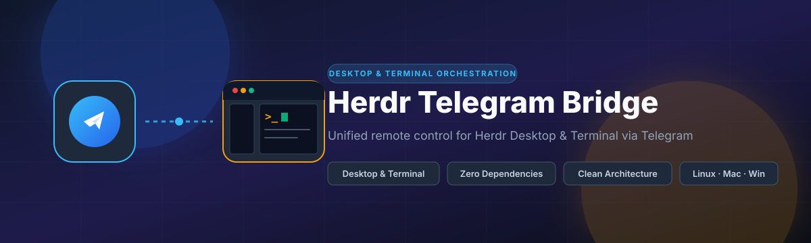
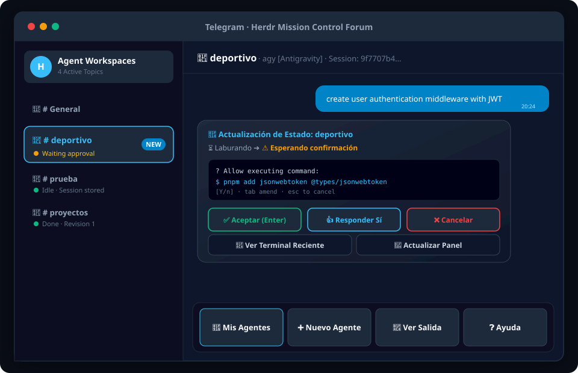
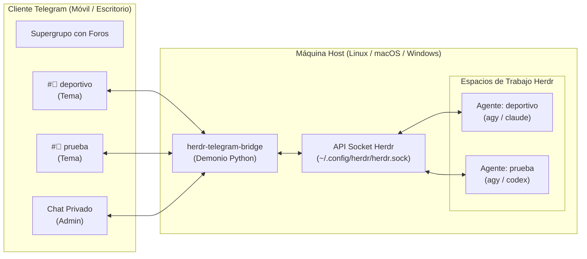

<p align="center">
  
</p>

<p align="center">
  <a href="LICENSE"></a>
  
  
  
</p>

<p align="center">
  <a href="README.md">English</a> • <b>Español</b>
</p>

Un puente ligero y sin dependencias externas entre **Supergrupos de Telegram con Foros** y [Herdr](https://herdr.dev) (el gestor de espacios de trabajo nativo para agentes). Permite monitorear, orquestar y aprobar múltiples agentes de programación con IA en tu máquina remota directamente desde tu teléfono móvil.

---

## Interfaz Visual

<p align="center">
  
</p>

---

## Características Principales

- **🖥️ Soporte Dual para Terminal y Escritorio**: Control transparente de agentes que se ejecutan en **Herdr Clásico** (CLI en terminal) y **Herdr Escritorio** (`herdr-app` / `herdr-core hc`) individualmente o en simultáneo con detección automática del backend.
- **🏗️ Arquitectura Limpia**: Diseño estricto Hexagonal (Puertos y Adaptadores) que aísla los modelos y reglas de negocio del transporte de Telegram y las herramientas CLI.
- **📱 Temas de Foro Dedicados**: Crea y vincula automáticamente un tema de Telegram por cada espacio de trabajo. Múltiples agentes pueden ejecutarse en paralelo sin mezclar sus conversaciones.
- **⚡ Instrucciones Directas**: Escribe en lenguaje natural dentro de cualquier tema para enviar la instrucción al agente correspondiente, sin necesidad de comandos barra (`/prompt`).
- **🔘 Botones Táctiles de Aprobación**: Recibe notificaciones en tiempo real cuando un agente requiera confirmación, con botones interactivos para `[Enter]`, `[Yes]` y `[Cancel]`.
- **💾 Persistencia de Sesión sin Base de Datos**: Captura el `session_id` del espacio de trabajo y recupera el contexto histórico mediante las transcripciones locales del agente, sin requerir SQLite, Redis o PostgreSQL.
- **🛡️ Seguridad por Lista Blanca**: Aplica autenticación estricta validando el ID de usuario de Telegram para proteger el acceso a la terminal del host.
- **📦 Cero Dependencias Externas**: Desarrollado exclusivamente con la biblioteca estándar de Python (`urllib`, `subprocess`, `json`, `threading`). No requiere `pip install` ni entornos virtuales.
- **🌐 Demonio Multiplataforma**: Scripts de servicio listos para ejecutar en segundo plano en **Linux** (`systemd`), **macOS** (`launchd`) y **Windows** (Programador de Tareas).

---

## Arquitectura General



> [!TIP]
> Consulta los detalles técnicos en la guía de [Arquitectura y Persistencia de Sesiones](docs/es/ARCHITECTURE.md).

---

## Inicio Rápido

### Requisitos Previos
1. **Python 3.8+**
2. **Herdr** instalado y disponible en la variable `PATH`
3. Un **Token de Bot de Telegram** obtenido de [@BotFather](https://t.me/BotFather) (ver [Guía de Configuración de Telegram](docs/es/SETUP_TELEGRAM.md))

---

### Instalación por Sistema Operativo

#### 🐧 Linux (`systemd --user`)
```bash
git clone https://github.com/smarriagac/herdr_telegram.git ~/proyectos/herdr-telegram-bridge
cd ~/proyectos/herdr-telegram-bridge
./install.sh
```
- Edita el archivo `~/.config/herdr-telegram/config.json`.
- Registros del servicio: `journalctl --user -u herdr-telegram.service -f`

#### 🍏 macOS (`launchd`)
```bash
git clone https://github.com/smarriagac/herdr_telegram.git ~/proyectos/herdr-telegram-bridge
cd ~/proyectos/herdr-telegram-bridge
./install.sh
```
- El instalador configura el agente de usuario en `~/Library/LaunchAgents/com.herdr.telegram.plist`.
- Registros del servicio: `tail -f ~/.config/herdr-telegram/bot.log`

#### 🪟 Windows (PowerShell y Programador de Tareas)
Abre PowerShell como usuario estándar:
```powershell
git clone https://github.com/smarriagac/herdr_telegram.git $HOME\proyectos\herdr-telegram-bridge
cd $HOME\proyectos\herdr-telegram-bridge
powershell -ExecutionPolicy Bypass -File .\install.ps1
```
- Registra una tarea programada en segundo plano con `pythonw.exe` (sin ventana de consola).
- Estado de la tarea: `Get-ScheduledTask -TaskName "HerdrTelegramBridge"`

---

## Referencia de Configuración

Edita el archivo `config.json` (ubicado en `~/.config/herdr-telegram/config.json` o `%APPDATA%\herdr-telegram\config.json`):

```json
{
  "bot_token": "123456789:ABCdefGHIjklMNOpqrSTUvwxYZ",
  "allowed_chat_id": 809438653,
  "group_chat_id": -1004353505956,
  "driver": "auto",
  "herdr_bin": "herdr",
  "herdr_app_bin": "herdr-app",
  "hc_bin": "hc",
  "projects_dir": "~/proyectos"
}
```

| Parámetro | Tipo | Requerido | Descripción |
|---|---|:---:|---|
| `bot_token` | `string` | **Sí** | Token HTTP API provisto por [@BotFather](https://t.me/BotFather). |
| `allowed_chat_id` | `integer` | **Sí** | ID de usuario de Telegram autorizado (seguridad de lista blanca). |
| `group_chat_id` | `integer` | No | ID del Supergrupo de Telegram con foros activados (inicia con `-100...`). |
| `driver` | `string` | No | Backend de ejecución: `"auto"` (detecta ambos), `"classic"`, o `"app"` (predeterminado: `"auto"`). |
| `herdr_bin` | `string` | No | Ruta al ejecutable de Herdr Clásico (predeterminado: `"herdr"`). |
| `herdr_app_bin` | `string` | No | Ruta al ejecutable de Herdr Escritorio (predeterminado: `"herdr-app"`). |
| `hc_bin` | `string` | No | Ruta al ejecutable de herdr-core (predeterminado: `"hc"`). |
| `projects_dir` | `string` | No | Directorio base para nuevos espacios de trabajo (predeterminado: `"~/proyectos"`). |

---

## Comandos y Controles Táctiles

### Dentro del Tema de un Espacio de Trabajo
| Acción | Descripción |
|---|---|
| `Texto libre en el chat` | Envía inmediatamente la instrucción o solicitud al agente. |
| `[Enter]` *(Botón / `/enter`)* | Envía `Enter` (ideal para confirmar ejecución de herramientas o menús interactivos). |
| `[Yes]` *(Botón / `/yes`)* | Envía `y` + `Enter`. |
| `[Cancel]` *(Botón / `/esc`)* | Envía `Escape` para cancelar diálogos de confirmación abiertos. |
| `/read` | Consulta las líneas recientes de la terminal del agente. |
| `/resume` | Reanuda la sesión del agente reteniendo todo el historial previo. |
| `/close` | Detiene el espacio de trabajo de Herdr y archiva el tema en Telegram. |

### En el Tema General o Chat Privado
| Comando | Descripción |
|---|---|
| `/status` o `/agents` | Panel interactivo con el estado, motor y session ID de todos los agentes. |
| `/new <nombre> [motor]` | Crea el directorio del proyecto, inicia el espacio de trabajo en Herdr y crea el tema en Telegram. |
| `/resume <nombre>` | Reanuda una sesión previa utilizando `--conversation <session_id>`. |
| `/read <nombre>` | Muestra la salida de terminal en vivo para un espacio de trabajo específico. |
| `/help` | Muestra la referencia de comandos y accesos rápidos. |

---

## Documentación

- 📖 [Guía de Configuración de Bot y Supergrupo en Telegram](docs/es/SETUP_TELEGRAM.md): Instrucciones detalladas para BotFather, activación de foros y permisos administrativos.
- 🏛️ [Arquitectura y Persistencia de Sesiones](docs/es/ARCHITECTURE.md): Funcionamiento interno del socket IPC, hilo observador y restauración de transcripciones sin base de datos.
- 🤝 [Guía de Contribución](docs/es/CONTRIBUTING.md): Estándares de código, Conventional Commits y pruebas locales.
- 📄 [Licencia MIT](LICENSE): Licencia de código abierto permisiva.

---

## Desinstalación

- **Linux / macOS**: Ejecutar `./uninstall.sh`
- **Windows**: Ejecutar `powershell -ExecutionPolicy Bypass -File .\uninstall.ps1`
