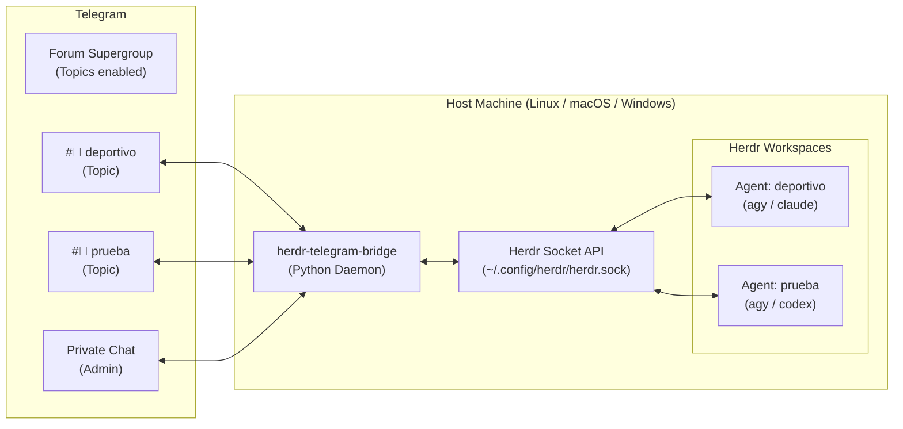

# Herdr Telegram Bridge

A lightweight, zero-dependency bridge between **Telegram** and [Herdr](https://herdr.dev) (the agent-native workspace manager). It allows you to monitor, control, and interact with multiple AI coding agents running on your remote machine directly from your phone.



## Features

- **Cross-Platform**: Native daemon support for **Linux** (`systemd --user`), **macOS** (`launchd`), and **Windows** (Task Scheduler with `pythonw.exe` or WSL2).
- **Zero External Dependencies**: Built entirely using Python's standard library (`urllib`, `subprocess`, `json`, `threading`). No virtual environment or `pip install` required.
- **Isolated Forum Topics**: Automatically manages dedicated Telegram topics for each Herdr workspace. Decisions, notifications, and prompts stay isolated without polluting each other's context.
- **Direct Prompting**: Inside any project topic, typing plain natural language immediately submits a prompt to that agent without requiring `/prompt` commands.
- **Interactive Inline Buttons**: Approve permission requests (`Enter`, `Yes`, `Cancel`), view live terminal outputs, or refresh the status panel with tactile touch controls.
- **Background Persistence**: Runs headlessly in the background, surviving sleep, logout, and terminal disconnects.

---

## Prerequisites

1. **Python 3.8+** (`python3` on Linux/macOS, `python.exe` / `pythonw.exe` on Windows).
2. **Herdr** installed and accessible in `PATH`.
3. A **Telegram Bot Token** from [@BotFather](https://t.me/BotFather).

---

## Installation by Operating System

### 🐧 Linux (systemd)

```bash
git clone <repo-url> ~/proyectos/herdr-telegram-bridge
cd ~/proyectos/herdr-telegram-bridge
./install.sh
```

- Edit `~/.config/herdr-telegram/config.json` with your credentials.
- Service management:
  ```bash
  systemctl --user status herdr-telegram.service
  journalctl --user -u herdr-telegram.service -f
  ```

---

### 🍏 macOS (launchd)

```bash
git clone <repo-url> ~/proyectos/herdr-telegram-bridge
cd ~/proyectos/herdr-telegram-bridge
./install.sh
```
The installer automatically detects macOS and installs a `launchd` user agent at `~/Library/LaunchAgents/com.herdr.telegram.plist`.

- Edit `~/.config/herdr-telegram/config.json` with your credentials.
- Agent management:
  ```bash
  # Check logs
  tail -f ~/.config/herdr-telegram/bot.log
  tail -f ~/.config/herdr-telegram/bot.err.log

  # Stop / Start
  launchctl unload ~/Library/LaunchAgents/com.herdr.telegram.plist
  launchctl load -w ~/Library/LaunchAgents/com.herdr.telegram.plist
  ```

---

### 🪟 Windows (Native or WSL2)

#### Option A: WSL2 (Recommended for dev environments)
Inside your WSL2 Ubuntu/Debian terminal, follow the **Linux** instructions above. Ensure systemd is enabled in `/etc/wsl.conf`.

#### Option B: Native Windows (PowerShell)
Open PowerShell (as standard user):
```powershell
git clone <repo-url> $HOME\proyectos\herdr-telegram-bridge
cd $HOME\proyectos\herdr-telegram-bridge
powershell -ExecutionPolicy Bypass -File .\install.ps1
```
The script copies the files to `%APPDATA%\herdr-telegram` and registers a Windows Scheduled Task (`HerdrTelegramBridge`) using `pythonw.exe` (no console window).

- Edit `%APPDATA%\herdr-telegram\config.json`.
- Task management:
  ```powershell
  # Start task
  Start-ScheduledTask -TaskName "HerdrTelegramBridge"

  # Stop task
  Stop-ScheduledTask -TaskName "HerdrTelegramBridge"

  # Check status
  Get-ScheduledTask -TaskName "HerdrTelegramBridge"
  ```

---

## Configuration Reference

`config.json` schema:

```json
{
  "bot_token": "123456789:ABCdefGHIjklMNOpqrSTUvwxYZ",
  "allowed_chat_id": 809438653,
  "group_chat_id": -1004353505956,
  "herdr_bin": "herdr",
  "projects_dir": "~/proyectos"
}
```

| Field | Description |
|---|---|
| `bot_token` | HTTP API token obtained from `@BotFather`. |
| `allowed_chat_id` | Your personal Telegram user ID (whitelist security). |
| `group_chat_id` | *(Optional)* The Telegram Supergroup ID with Topics enabled. |
| `herdr_bin` | Path to the `herdr` executable (`herdr` or absolute path). |
| `projects_dir` | Base directory where new projects are created. |

---

## Telegram Setup (Forum Supergroup)

To enable topic isolation:
1. Create a new Telegram group and add your bot.
2. In group settings:
   - Enable **Topics** (Modo Foro).
   - Promote your bot to **Administrator** with the **Manage Topics** permission.
3. Send any message in the group. Retrieve the group's `chat_id` (negative integer starting with `-100...`) from the service logs.
4. Set `"group_chat_id"` in `config.json` and restart the service.

---

## Commands & Controls

### In Dedicated Project Topics
- **Plain text message**: Directly submits an instruction/prompt to the agent.
- `/read`: Inspects recent terminal output for this agent.
- `/enter`: Sends `Enter` (useful when approving prompts).
- `/yes`: Sends `y` + `Enter`.
- `/esc`: Sends `Escape` to cancel an open dialog.
- `/close`: Closes the Herdr workspace and archives the topic.

### In General Topic or Private Chat
- `/status` or `/agents`: Displays interactive dashboard of all workspaces.
- `/new <name> [engine]`: Creates a project folder, spawns a Herdr workspace, launches the agent (default: `agy`), and creates a Telegram topic.
- `/read <name>`: Reads the terminal of a specific workspace.
- `/help`: Displays available commands.

---

## Uninstallation

- **Linux / macOS**: Run `./uninstall.sh`.
- **Windows**: Run `powershell -ExecutionPolicy Bypass -File .\uninstall.ps1`.
