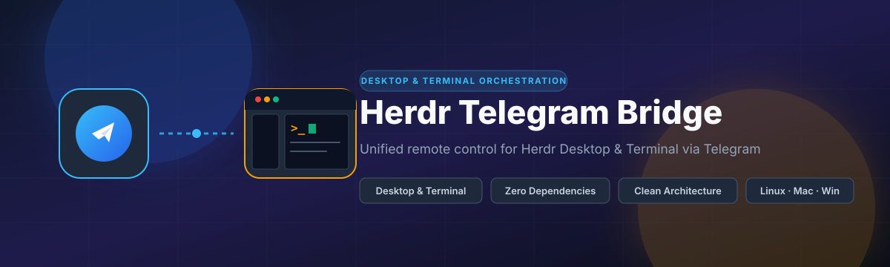
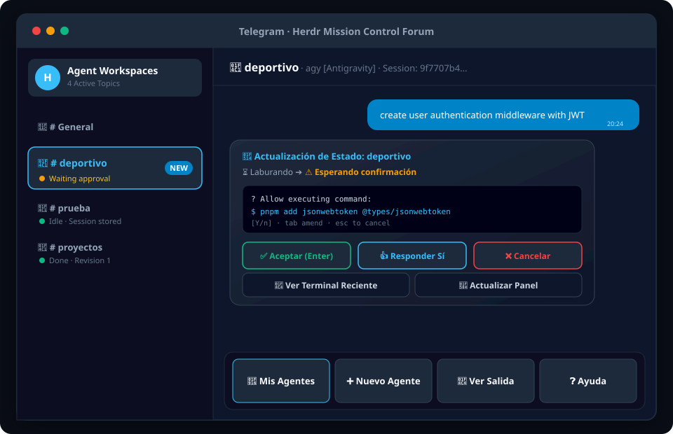
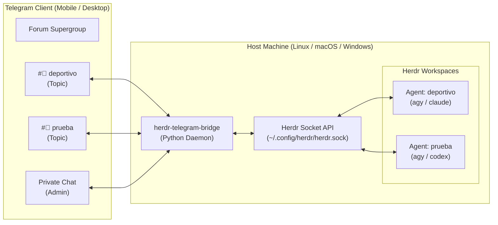

<p align="center">
  
</p>

<p align="center">
  <a href="LICENSE"></a>
  
  
  
  
</p>

<p align="center">
  <b>English</b> • <a href="README.es.md">Español</a>
</p>

A lightweight, zero-dependency bridge between **Telegram Forum Supergroups** and [Herdr](https://herdr.dev) (the agent-native workspace manager). Monitor, orchestrate, and approve multiple AI coding agents running on your remote machine directly from your phone.

---

## Visual Interface

<p align="center">
  
</p>

---

## Key Features

- **🖥️ Dual Terminal & Desktop Support**: Seamlessly controls agents running on **Herdr Classic** (terminal CLI) and **Herdr Desktop** (`herdr-app` / `herdr-core hc`) individually or simultaneously with automatic backend detection.
- **🏗️ Clean Architecture**: Strict Hexagonal (Ports & Adapters) design separating pure domain models from CLI drivers and transport protocols.
- **📱 Dedicated Forum Topics**: Automatically creates and binds a Telegram topic for each workspace. Multiple coding agents can run concurrently without interleaving chats.
- **⚡ Natural Prompting**: Write natural language inside any project topic to prompt that agent directly—no slash commands needed.
- **🔘 Tactile Approval Controls**: Receive real-time notifications when an agent requires confirmation, with inline buttons for `[Enter]`, `[Yes]`, and `[Cancel]`.
- **💾 Zero-Database Session Persistence**: Captures workspace `session_id` and restores historical conversation context via local agent transcripts without SQLite, Redis, or PostgreSQL.
- **🛡️ Strict Whitelist Security**: Enforces personal Telegram user whitelist authentication to protect your host terminal.
- **📦 Zero External Dependencies**: Powered entirely by the Python standard library (`urllib`, `subprocess`, `json`, `threading`). No `pip install` or virtual environments required.
- **🌐 Cross-Platform Daemon**: Ready-to-use background service scripts for **Linux** (`systemd`), **macOS** (`launchd`), and **Windows** (Task Scheduler).

---

## Architecture at a Glance



> [!TIP]
> Read the complete deep-dive in [Architecture & Session Persistence](docs/ARCHITECTURE.md) or explore the [interactive Archify diagram](docs/architecture-detailed.html).

---

## Quickstart

### Prerequisites
1. **Python 3.8+**
2. **Herdr** installed and available in `PATH`
3. A **Telegram Bot Token** from [@BotFather](https://t.me/BotFather) (see [Telegram Setup Guide](docs/SETUP_TELEGRAM.md))

---

### Installation by OS

#### 🐧 Linux (`systemd --user`)
```bash
git clone https://github.com/smarriagac/herdr-telegram-bridge.git ~/proyectos/herdr-telegram-bridge
cd ~/proyectos/herdr-telegram-bridge
./install.sh
```
- Edit `~/.config/herdr-telegram/config.json`.
- Daemon logs: `journalctl --user -u herdr-telegram.service -f`

#### 🍏 macOS (`launchd`)
```bash
git clone https://github.com/smarriagac/herdr-telegram-bridge.git ~/proyectos/herdr-telegram-bridge
cd ~/proyectos/herdr-telegram-bridge
./install.sh
```
- The installer creates `~/Library/LaunchAgents/com.herdr.telegram.plist`.
- Daemon logs: `tail -f ~/.config/herdr-telegram/bot.log`

#### 🪟 Windows (PowerShell & Task Scheduler)
Open standard PowerShell:
```powershell
git clone https://github.com/smarriagac/herdr-telegram-bridge.git $HOME\proyectos\herdr-telegram-bridge
cd $HOME\proyectos\herdr-telegram-bridge
powershell -ExecutionPolicy Bypass -File .\install.ps1
```
- Registers a background Windows Task using `pythonw.exe` (no terminal window).
- Task management: `Get-ScheduledTask -TaskName "HerdrTelegramBridge"`

---

## Configuration Reference

Edit `config.json` (stored at `~/.config/herdr-telegram/config.json` or `%APPDATA%\herdr-telegram\config.json`):

```json
{
  "bot_token": "123456789:ABCdefGHIjklMNOpqrSTUvwxYZ",
  "allowed_chat_id": 809438653,
  "group_chat_id": -1004353505956,
  "driver": "auto",
  "herdr_bin": "herdr",
  "herdr_app_bin": "herdr-app",
  "hc_bin": "hc",
  "projects_dir": "~/proyectos"
}
```

| Parameter | Type | Required | Description |
|---|---|:---:|---|
| `bot_token` | `string` | **Yes** | HTTP Bot API token from [@BotFather](https://t.me/BotFather). |
| `allowed_chat_id` | `integer` | **Yes** | Whitelisted personal Telegram user ID. |
| `group_chat_id` | `integer` | No | Telegram Forum Supergroup ID (starts with `-100...`). |
| `driver` | `string` | No | Execution backend: `"auto"` (detect both), `"classic"`, or `"app"` (default: `"auto"`). |
| `herdr_bin` | `string` | No | Path to Herdr Classic executable (default: `"herdr"`). |
| `herdr_app_bin` | `string` | No | Path to Herdr Desktop executable (default: `"herdr-app"`). |
| `hc_bin` | `string` | No | Path to herdr-core executable (default: `"hc"`). |
| `projects_dir` | `string` | No | Base directory for new workspaces (default: `"~/proyectos"`). |

---

## Commands & Touch Controls

### In Workspace Topics
| Action | Description |
|---|---|
| `Plain message text` | Immediately dispatches instruction/prompt to the agent. |
| `[Enter]` *(Button / `/enter`)* | Sends `Enter` (useful for approving tool executions or interactive menus). |
| `[Yes]` *(Button / `/yes`)* | Sends `y` + `Enter`. |
| `[Cancel]` *(Button / `/esc`)* | Sends `Escape` to cancel pending execution dialogs. |
| `/read` | Fetches recent terminal output from the agent session. |
| `/resume` | Resumes a stopped agent session, retaining full context. |
| `/close` | Stops the agent workspace and archives the Telegram topic. |

### In General Topic or Direct Message
| Command | Description |
|---|---|
| `/status` or `/agents` | Interactive dashboard displaying all running agents, engines, and status. |
| `/new <name> [engine]` | Creates project directory, launches Herdr workspace, and creates topic. |
| `/resume <name>` | Restores a previous agent session via `--conversation <session_id>`. |
| `/read <name>` | Displays live terminal output for a specific workspace. |
| `/help` | Shows command reference and active shortcuts. |

---

## Documentation

- 📖 [Telegram Bot & Supergroup Setup Guide](docs/SETUP_TELEGRAM.md): Step-by-step instructions for BotFather, Topics configuration, and permission setup.
- 🏛️ [Architecture & Session Persistence](docs/ARCHITECTURE.md): Deep-dive into socket IPC, real-time watcher thread, and zero-DB transcript recovery.
- 🤝 [Contributing Guidelines](docs/CONTRIBUTING.md): Code standards, conventional commits, and local testing.
- 📄 [MIT License](LICENSE): Permissive open-source license.

---

## Uninstallation

- **Linux / macOS**: Run `./uninstall.sh`
- **Windows**: Run `powershell -ExecutionPolicy Bypass -File .\uninstall.ps1`
