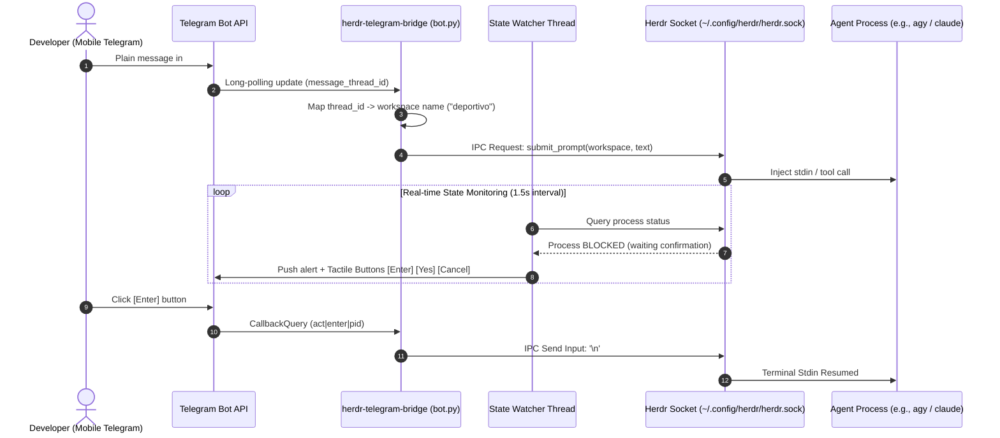
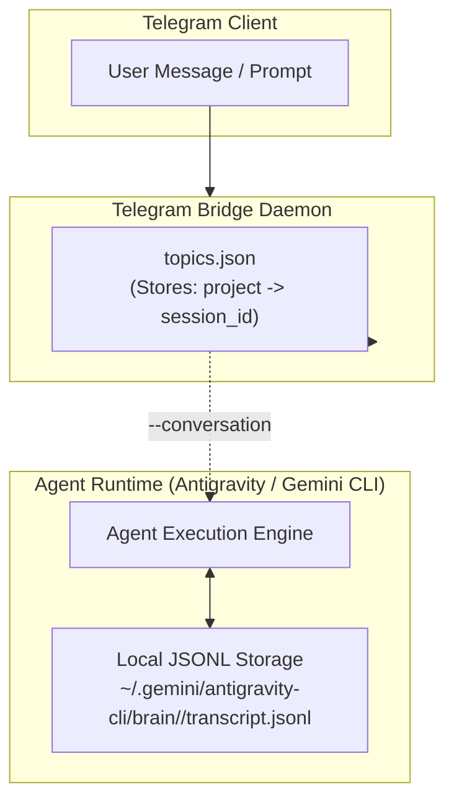

# Architecture & Runtime Design

An in-depth guide to how `herdr-telegram-bridge` bridges Telegram Forum Topics, Herdr Unix domain sockets, and autonomous AI coding agents with zero external database dependencies.

<p align="right">
  <a href="es/ARCHITECTURE.md">Leer en Español</a>
</p>

---

## System Overview



---

## Core Components

### 1. Telegram Polling & Whitelist Dispatcher
The main thread continuously polls Telegram's `getUpdates` endpoint using standard library `urllib.request`. 
- **Security Whitelist**: Every update is authenticated against `allowed_chat_id` and `group_chat_id`. Any message from an unauthorized Telegram user ID is discarded immediately.
- **Context Routing**:
  - Messages in `group_chat_id` with a `message_thread_id` are routed to that workspace's dedicated agent.
  - Messages without a thread ID (or in direct private chat) are treated as administrative commands (`/status`, `/new`, `/resume`, `/help`).

### 2. Herdr Socket IPC Layer
Herdr exposes a lightweight Unix domain socket (`~/.config/herdr/herdr.sock`) for low-latency agent orchestration.
- **Protocol**: JSON-RPC over local socket connection.
- **Fallback**: If the socket is unavailable or running on platforms without Unix sockets, commands gracefully degrade to CLI invocation (`herdr workspace ...`, `herdr prompt ...`).

### 3. Topic-to-Workspace State Map (`topics.json`)
Workspace bindings are persisted in a simple atomic JSON file (`~/.config/herdr/topics.json` or platform equivalent):

```json
{
  "deportivo": {
    "thread_id": 4,
    "created_at": "2026-10-31T20:30:00Z",
    "engine": "agy",
    "session_id": "16bb7d4d-18e3-40da-bec0-c5e9cf29caa5"
  }
}
```

This ensures complete state recovery even if the daemon crashes, the host machine reboots, or network connection drops.

### 4. Background State Watcher & Proactive Notifications
A background worker thread (`state_watcher_thread`) periodically queries active processes:
- **Status Change Detection**: Monitors agent transitions (`running`, `idle`, `blocked`, `stopped`).
- **Interactive Prompts**: When an agent requests tool execution confirmation, the bridge sends a tactile inline keyboard (`[Enter]`, `[Yes]`, `[Cancel]`, `[Inspect Terminal]`) directly to the relevant topic.
- **Resilient Callback Parsing**: Button callbacks use a pipe-delimited schema (`act|<action>|<pid>`) ensuring unambiguous routing regardless of process argument whitespace.

---

## Zero-Database Session Persistence

A common architectural question: *Why does the bridge not need SQLite, PostgreSQL, or Redis to store multi-agent conversation history?*



### The Persistence Lifecycle
1. **Initial Creation**: When `/new <name>` or `herdr new` launches an agent, the runtime registers a unique UUID for the conversation (`session_id`).
2. **Metadata Sync**: The bridge captures this `session_id` directly from Herdr's process metadata and persists it in `topics.json`.
3. **Local JSONL Storage**: The agent engine natively appends every user prompt, tool call, thinking trace, and model response to its local transcript on disk (`transcript.jsonl`).
4. **Context Recovery (`/resume`)**: When an agent session terminates or machine reboots, executing `/resume <name>` re-invokes:
   ```bash
   herdr workspace run <name> agy --conversation <session_id>
   ```
5. **Seamless Continuation**: The agent engine reloads its historical context directly from the local JSONL file, allowing the user to pick up conversation history without any external database infrastructure.

---

## Reliability & Fault Tolerance

| Scenario | Behavior | Recovery Action |
|---|---|---|
| **Daemon Crash / Killed** | Service supervisor restarts daemon automatically (`systemd` / `launchd` / Task Scheduler). | Daemon re-reads `topics.json` on startup and resumes Telegram polling. |
| **Agent Hangs / Blocks** | State Watcher detects blocked status and pushes inline buttons to topic. | User clicks `[Cancel]` or `[Enter]` on Telegram to unblock the shell. |
| **Network Interruption** | `urllib` requests timeout gracefully with exponential backoff. | Polling resumes automatically once network connectivity is restored. |
| **Host Machine Reboot** | Background daemon starts on boot via user service target. | Workspaces can be resumed on demand via `/resume <name>` or automatically. |

---

## Next Steps

- Review the [Setup Guide](SETUP_TELEGRAM.md) to initialize your bot and supergroup.
- Refer to [Contributing Guidelines](CONTRIBUTING.md) to submit improvements or bug fixes.
