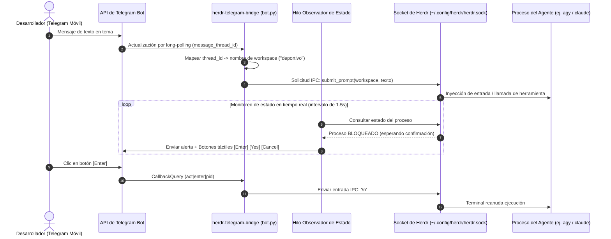
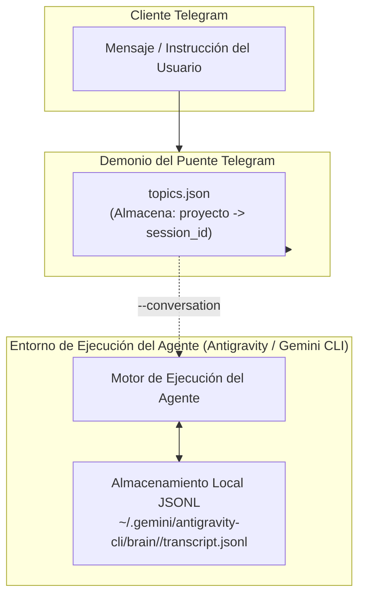

# Arquitectura y Diseño en Tiempo de Ejecución

Guía técnica detallada sobre la comunicación entre los Foros de Telegram, los sockets de dominio Unix de Herdr y la persistencia de agentes de IA sin requerir bases de datos externas.

<p align="right">
  <a href="../ARCHITECTURE.md">Read in English</a>
</p>

---

## Visión General del Sistema



---

## Arquitectura Limpia (Hexagonal / Puertos y Adaptadores)

La base de código está estructurada según los principios de la **Arquitectura Limpia** para aislar las reglas de negocio de los frameworks, APIs externas y herramientas de terminal:

```
src/bridge/
├── domain/                  # Entidades del dominio y reglas de negocio puras
│   ├── models.py            # AgentInfo, TopicBinding, ProcessStatus
│   └── ports.py             # HerdrDriverPort, StateRepositoryPort, TelegramPort
├── adapters/                # Implementaciones de infraestructura de los puertos
│   ├── drivers/             # Adaptadores de ejecución de agentes
│   │   ├── classic_driver.py   # Herdr Clásico (CLI herdr / socket)
│   │   ├── app_driver.py       # Herdr Escritorio (herdr-app do / herdr-core hc)
│   │   └── composite_driver.py # Controlador dual unificado con autodetección
│   ├── persistence/         # Adaptadores de persistencia
│   │   └── json_topic_repository.py  # Almacenamiento atómico de topics.json
│   └── telegram/            # Adaptadores de comunicación con Telegram
│       └── telegram_client.py        # Cliente HTTP de Telegram con biblioteca estándar
├── application/             # Casos de uso y orquestación de la aplicación
│   ├── agent_service.py     # Operaciones del ciclo de vida de agentes y espacios
│   ├── state_watcher.py     # Hilo en segundo plano que monitorea estados
│   └── bot_controller.py    # Despachador de mensajes y comandos de Telegram
├── config.py                # Carga y validación de configuración
└── main.py                  # Raíz de composición e inyección de dependencias
```

### Arquitectura de Controlador Dual: Terminal y Escritorio Unificados

El puente soporta ambos ecosistemas de Herdr de forma transparente:
1. **`ClassicHerdrDriver`**: Se comunica con el multiplexor tradicional `herdr` (`herdr server`, `~/.config/herdr/herdr.sock`, `herdr workspace`, `herdr agent`).
2. **`HerdrAppDriver`**: Se comunica con la aplicación **Herdr Desktop** (`herdr-app do space.new`, `herdr-app ls`) y su motor de ejecución nativo **herdr-core** (`hc send`, `hc read`, `hc wait`, `hc keys`).
3. **`CompositeHerdrDriver` (`"driver": "auto"`)**:
   - Detecta agentes ejecutándose simultáneamente tanto en espacios de la Terminal como en el Escritorio.
   - Enrutamiento inteligente: analiza el formato de los identificadores (`w1:t1:p1` frente a `t1` / `sp...`) y los nombres de proyectos para despachar las órdenes y teclas al controlador correcto sin intervención del usuario.

---

## Componentes Principales

### 1. Sondeo de Telegram y Despachador con Lista Blanca
El hilo principal consulta continuamente el endpoint `getUpdates` de Telegram mediante `urllib.request` de la biblioteca estándar.
- **Lista Blanca de Seguridad**: Cada actualización se valida contra `allowed_chat_id` y `group_chat_id`. Cualquier mensaje originado por un usuario no autorizado se descarta de forma inmediata.
- **Enrutamiento por Contexto**:
  - Los mensajes enviados dentro de `group_chat_id` con un `message_thread_id` se enrutan al agente dedicado a ese proyecto.
  - Los mensajes sin identificador de hilo (o enviados en chat privado directo) se procesan como comandos administrativos (`/status`, `/new`, `/resume`, `/help`).

### 2. Capa de Comunicación IPC por Socket de Herdr
Herdr expone un socket de dominio Unix (`~/.config/herdr/herdr.sock`) optimizado para baja latencia.
- **Protocolo**: Solicitudes JSON-RPC a través de conexión local por socket.
- **Mecanismo de Respaldo**: Si el socket no está disponible o la plataforma carece de soporte de sockets Unix, el puente conmuta a invocaciones por línea de comandos (`herdr workspace ...`, `herdr prompt ...`).

### 3. Mapa de Estado de Temas y Espacios de Trabajo (`topics.json`)
La asociación entre temas y proyectos se guarda atómicamente en formato JSON (`~/.config/herdr/topics.json` o la ruta correspondiente según la plataforma):

```json
{
  "deportivo": {
    "thread_id": 4,
    "created_at": "2026-10-31T20:30:00Z",
    "engine": "agy",
    "session_id": "16bb7d4d-18e3-40da-bec0-c5e9cf29caa5"
  }
}
```

Esto garantiza la recuperación completa del estado incluso ante reinicios del sistema operativo, caídas del proceso o pérdida temporal de conexión.

### 4. Hilo Observador de Estado y Notificaciones Proactivas
Un hilo secundario (`state_watcher_thread`) sondea periódicamente los procesos activos:
- **Detección de Cambios de Estado**: Monitorea transiciones del agente (`running`, `idle`, `blocked`, `stopped`).
- **Confirmaciones Interactivas**: Cuando un agente requiere confirmación para ejecutar una herramienta, el puente envía un teclado en línea con botones táctiles (`[Enter]`, `[Yes]`, `[Cancel]`, `[Ver Terminal]`) directamente al tema en cuestión.
- **Análisis Robusto de Callbacks**: Las respuestas de los botones emplean un esquema delimitado por barras verticales (`act|<accion>|<pid>`), asegurando un parseo unívoco ante argumentos con espacios.

---

## Persistencia de Sesión sin Base de Datos

Una inquietud frecuente de diseño es: *¿Por qué el puente no requiere SQLite, PostgreSQL o Redis para conservar el historial de conversaciones multiagente?*



### Ciclo de Vida de la Persistencia
1. **Creación Inicial**: Cuando se lanza un agente con `/new <nombre>` o `herdr new`, el motor registra un identificador único universal para la conversación (`session_id`).
2. **Sincronización de Metadatos**: El puente extrae este `session_id` desde los metadatos del proceso en Herdr y lo persiste en `topics.json`.
3. **Almacenamiento JSONL Local**: El motor del agente almacena de forma nativa cada instrucción del usuario, llamada a herramientas, trazas de razonamiento y respuestas en su archivo local en disco (`transcript.jsonl`).
4. **Recuperación de Contexto (`/resume`)**: Al reiniciar la máquina o reanudar una sesión detenida, el comando `/resume <nombre>` invoca internamente:
   ```bash
   herdr workspace run <nombre> agy --conversation <session_id>
   ```
5. **Continuidad Transparente**: El motor del agente recarga el contexto histórico desde el archivo JSONL local, permitiendo continuar la conversación sin requerir infraestructura adicional de bases de datos.

---

## Tolerancia a Fallos y Resiliencia

| Escenario | Comportamiento del Sistema | Acción de Recuperación |
|---|---|---|
| **Caída o Detención del Demonio** | El supervisor de servicios reinicia el proceso automáticamente (`systemd` / `launchd` / Programador de Tareas). | El demonio recarga `topics.json` al iniciar y retoma el sondeo de Telegram. |
| **Agente Bloqueado esperando Confirmación** | El hilo observador detecta el estado bloqueado y envía los botones táctiles al tema. | El usuario presiona `[Enter]` o `[Cancel]` en Telegram para desbloquear la terminal. |
| **Interrupción de Red** | Las solicitudes con `urllib` gestionan el tiempo de espera con reintentos progresivos. | El sondeo se restablece de forma automática en cuanto regresa la conectividad. |
| **Reinicio del Servidor Host** | El servicio arranca en el encendido mediante el target de usuario. | Los agentes se reanudan a demanda con `/resume <nombre>` manteniendo su contexto. |

---

## Siguientes Pasos

- Consulta la [Guía de Configuración de Telegram](SETUP_TELEGRAM.md) para inicializar tu bot y supergrupo.
- Revisa las [Directrices de Contribución](CONTRIBUTING.md) para enviar mejoras o correcciones de código.
